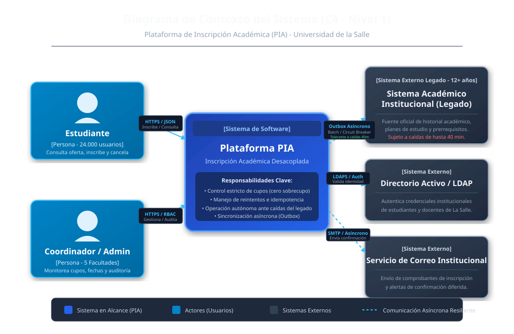
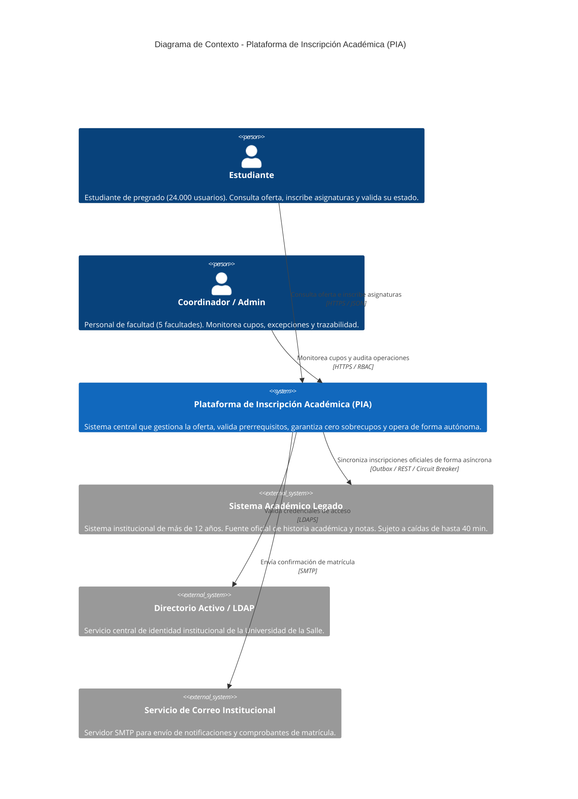
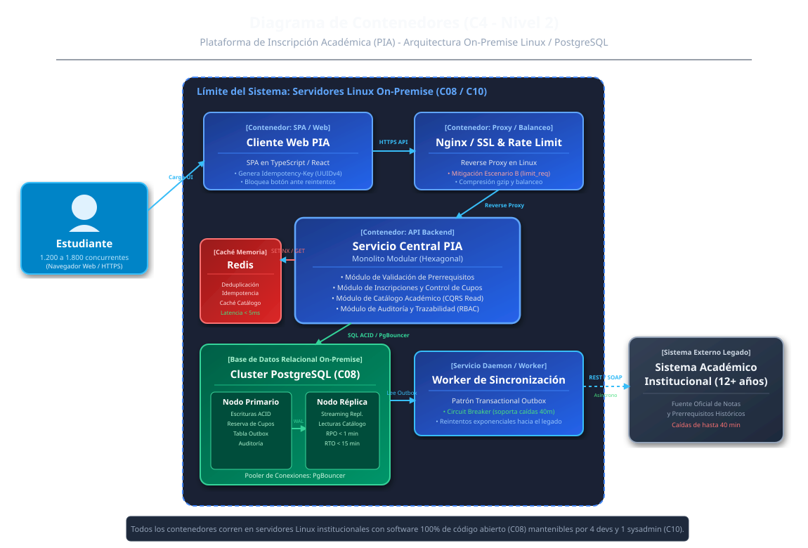
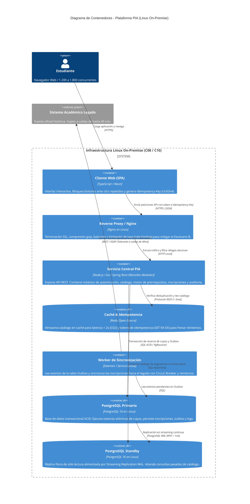
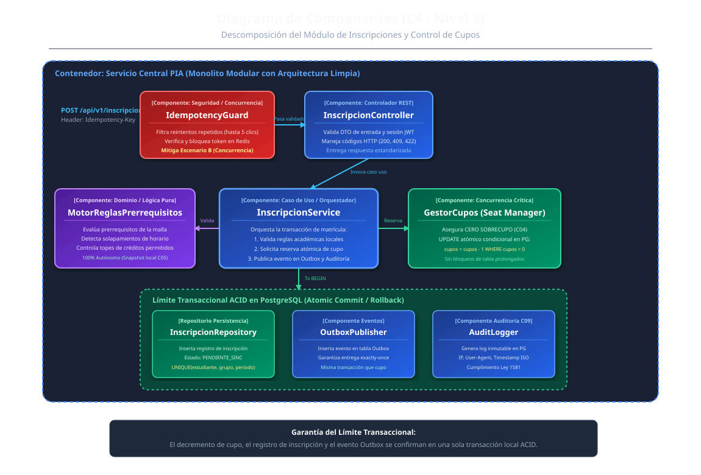
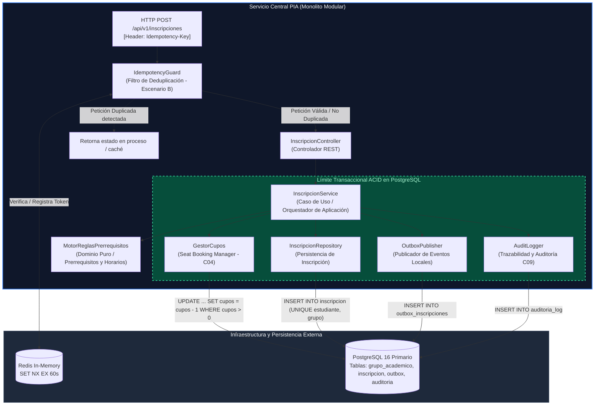

# Propuesta Arquitectónica: Plataforma de Inscripción Académica (PIA)
## Universidad de la Salle
**Documento de Trabajo:** Actividad 2 - Diseño de la Estructura Arquitectónica  
**Estudiante:** Noah Van Otterdijk Silva - 1023030297  
**Escenario Asignado:** Escenario B (Último dígito impar = 7: Concurrencia +50% y hasta 5 reintentos por usuario)  
**Fecha:** Octubre de 2026  
**Versión:** 1.0  

---

## 1. Selección y Justificación del Estilo Arquitectónico

Como estudiante de ingeniería de software a cargo del diseño estructural de la PIA, la selección del estilo arquitectónico debe responder estrictamente a las restricciones institucionales y a los drivers identificados en la Actividad 1. No buscamos sumar componentes artificiales por moda tecnológica, sino garantizar que la plataforma sea gobernable por el equipo disponible y altamente eficiente bajo estrés.

### 1.1. Análisis de Alternativas Consideradas

| Alternativa Evaluada | Ventajas Potenciales | Desventajas y Riesgos en el Contexto de La Salle | Veredicto |
| :--- | :--- | :--- | :--- |
| **Monolito Tradicional en Capas (Layered Monolith)** | Familiaridad para el equipo; desarrollo inicial rápido. | Tiende a degradarse en un acoplamiento descontrolado (*Big Ball of Mud*). Las reglas de negocio quedan mezcladas con la persistencia, dificultando pruebas unitarias de prerrequisitos y aislamientos transaccionales. | **Descartada** |
| **Microservicios Distribuidos** | Despliegue independiente; escalabilidad granular por servicio. | **Inviable para la realidad del proyecto:** Demanda orquestadores complejos (Kubernetes), transacciones distribuidas (Saga/2PC) propensas a sobrecupos, alta latencia de red entre servicios y una sobrecarga operativa inasumible para **4 desarrolladores y 1 administrador de sistemas** (C10) en infraestructura local (C08). Viola el principio de no sobreingeniería. | **Descartada** |
| **Monolito Modular con Arquitectura Limpia / Hexagonal (Modular Monolith)** | **Límites modulares estrictos** en código; dominio aislado de frameworks; transacciones ACID locales confiables; despliegue simple y ligero en Linux; cero latencia de red intermódulo. | Requiere disciplina de equipo para respetar fronteras de paquetes y no violar accesos directos entre módulos sin pasar por interfaces públicas. | **SELECCIONADA** |

### 1.2. Justificación de la Elección: Monolito Modular Hexagonal

El **Monolito Modular con Arquitectura Hexagonal (Puertos y Adaptadores)** es la solución óptima para la Universidad de la Salle por las siguientes razones de peso:

1. **Gobernabilidad y Realidad Operativa (C10):** Un equipo de 4 desarrolladores y 1 administrador puede compilar, probar, desplegar y monitorear un único artefacto modularizado (junto a un worker de fondo) sin la pesadilla de mantener 8 pipelines de CI/CD, balanceadores internos o mallas de servicios (*service meshes*).
2. **Consistencia Transaccional Estricta (C04 / DRV-01 - Cero Sobrecupo):** En un monolito modular, la reserva de cupo y el registro de la inscripción se ejecutan en una transacción local ACID dentro de PostgreSQL. No hay incertidumbre de estados intermedios ni transacciones distribuidas fallidas.
3. **Alto Rendimiento y Baja Latencia (C01, C02, Escenario B):** Las invocaciones entre el controlador, el motor de prerrequisitos y el gestor de cupos son llamadas en memoria (nanosegundos), eliminando el *overhead* de serialización HTTP/gRPC presente en microservicios.
4. **Desacoplamiento del Sistema Legado (C05 / Escenario A):** La arquitectura aísla la comunicación externa en un adaptador secundario y un worker asíncrono (*Outbox*), asegurando que la caída de 40 minutos del sistema viejo no detenga la ejecución interna de la PIA.
5. **Alineación con Infraestructura Linux/PostgreSQL (C08):** Se ejecuta de forma nativa y eficiente sobre servidores Linux existentes mediante procesos supervisados (Docker o systemd), maximizando los recursos de hardware sin requerir costos de licenciamiento en la nube.

---

## 2. Modelo C4 - Diagramas y Estructura Arquitectónica

La arquitectura se documenta mediante los tres primeros niveles del **Modelo C4** (*Context, Containers, Components*), complementando diagramas vectoriales SVG de alta definición con diagramas interpretables en Mermaid.

---

### 2.1. Nivel 1: Diagrama de Contexto del Sistema

El diagrama de contexto establece los límites de la PIA, identificando a los usuarios humanos y los sistemas externos con los que interactúa dentro del campus universitario.

#### Diagrama Vectorial (SVG)
El diagrama vectorial formal se encuentra disponible en:  
`docs/diagramas/c4_nivel1_contexto.svg`



#### Representación Mermaid



#### Descripción de Actores y Sistemas Externos

| Elemento | Tipo | Rol y Responsabilidad en la Arquitectura | Mecanismo de Interacción |
| :--- | :--- | :--- | :--- |
| **Estudiante** | Actor Humano | Usuario principal. Realiza consultas masivas de horarios y envía solicitudes de inscripción durante su franja de matrícula. | Navegador Web / HTTPS |
| **Coordinador / Auditor** | Actor Humano | Personal académico de las 5 facultades. Supervisa disponibilidad de grupos y consulta registros de trazabilidad ante reclamos. | Portal Web Administrativo / RBAC |
| **Plataforma PIA** | Sistema Central | Sistema objeto de diseño. Controla cupos, ejecuta reglas académicas en local y aísla al usuario de las fallas del legado. | API REST / PostgreSQL / Redis |
| **Sistema Académico Legado** | Sistema Externo | Repositorio maestro histórico de asignaturas aprobadas y notas. Recibe las inscripciones consolidadas del período. | Asíncrono vía Outbox Worker con Circuit Breaker |
| **Directorio Activo / LDAP** | Sistema Externo | Servicio de autenticación institucional único para estudiantes y docentes. | LDAPS seguro |
| **Servidor de Correo** | Sistema Externo | Notifica al estudiante el resultado final de su inscripción o contingencias. | SMTP asíncrono desacoplado |

---

### 2.2. Nivel 2: Diagrama de Contenedores

El diagrama de contenedores describe las aplicaciones ejecutables, los servicios de almacenamiento, las fronteras tecnológicas y la distribución sobre la infraestructura Linux institucional (C08).

#### Diagrama Vectorial (SVG)
El diagrama vectorial formal se encuentra disponible en:  
`docs/diagramas/c4_nivel2_contenedores.svg`



#### Representación Mermaid



#### Justificación y Responsabilidad de los Contenedores

1. **Cliente Web (SPA):** Se ejecuta en el navegador del estudiante. Incorpora lógica proactiva contra el **Escenario B**: deshabilita visualmente los botones de acción al hacer el primer clic y genera un identificador único por transacción (`Idempotency-Key` formato UUIDv4).
2. **Reverse Proxy (Nginx en Linux):** Punto único de entrada. Aplica directivas de `limit_req_zone` para atenuar ráfagas anormales de peticiones del mismo usuario/IP, protegiendo al backend de saturación.
3. **Servicio Central PIA (Monolito Modular):** Ejecuta la lógica del negocio. Al ser un solo artefacto desplegado en Linux, elimina la latencia de red entre servicios y garantiza transacciones locales seguras.
4. **Caché en Memoria (Redis):** Esencial para dos drivers críticos:
   - **Rendimiento (C02):** Guarda la oferta académica precalculada en memoria, permitiendo que el 95% de las consultas se despachen en menos de 50 ms.
   - **Idempotencia (Escenario B):** Almacena claves temporales atómicas (`SET key student_id NX EX 60`). Si entran 5 peticiones simultáneas del mismo estudiante, solo la primera pasa; las otras 4 son detenidas en milisegundos.
5. **Base de Datos PostgreSQL (Primario y Réplica):** 
   - Utiliza **PgBouncer** como agrupador de conexiones (*connection pooler*) para que 1.800 usuarios concurrentes no agoten la memoria de PostgreSQL.
   - El **Primario** atiende escrituras atómicas de cupo y eventos *Outbox*.
   - La **Réplica Standby** recibe replicación continua de registros WAL (*Write-Ahead Logging*), asegurando un **RPO $< 1$ minuto** y un **RTO $< 15$ minutos** ante desastres (C06, C07).
6. **Worker de Sincronización Asíncrona (Outbox Worker):** Proceso desacoplado que vacía la tabla `outbox_inscripciones`. Posee un *Circuit Breaker*: si el legado cae durante 40 minutos (C05 / Escenario A), el worker suspende los envíos, espera pacientemente y reanuda la sincronización de forma ordenada al volver el servicio, sin perder ni una sola inscripción.

---

### 2.3. Nivel 3: Diagrama de Componentes (Módulo de Inscripciones y Control de Cupos)

Este diagrama descompone internamente el módulo más crítico del sistema: aquel donde se reciben las solicitudes de matrícula, se validan los prerrequisitos y se reserva el cupo sin riesgo de sobrecupos.

#### Diagrama Vectorial (SVG)
El diagrama vectorial formal se encuentra disponible en:  
`docs/diagramas/c4_nivel3_componentes.svg`



#### Representación Mermaid



#### Responsabilidades de los Componentes

| Componente | Rol en la Arquitectura | Responsabilidad Concreta | Justificación de su Existencia |
| :--- | :--- | :--- | :--- |
| **`IdempotencyGuard`** | Filtro de Seguridad / Concurrencia | Intercepta la petición HTTP antes de llegar a la lógica de negocio. Valida la clave de idempotencia en Redis con operación atómica `SET NX`. | **Vital para el Escenario B:** Detiene en seco hasta 5 reintentos automáticos, devolviendo la respuesta original sin tocar PostgreSQL. |
| **`InscripcionController`** | Adaptador Primario (Entrada REST) | Deserializa el JSON, valida la estructura sintáctica de los datos (DTO) y la identidad del estudiante mediante el token JWT. | Aísla los protocolos web de la lógica de negocio. |
| **`InscripcionService`** | Servicio de Aplicación (Caso de Uso) | Orquesta los pasos del proceso: validación de reglas, reserva atómica, registro de datos y emisión del evento de integración. | Mantiene la coherencia del caso de uso y coordina la transacción. |
| **`MotorReglasPrerrequisitos`** | Núcleo de Dominio Limpio | Evalúa las reglas de negocio académicas: prerrequisitos aprobados, topes de créditos y cruces de horario. | **Autonomía total (C05 / Escenario A):** Opera contra el snapshot local pre-cargado; no depende del sistema legado en tiempo de ejecución. |
| **`GestorCupos`** | Gestor de Concurrencia Crítica | Ejecuta la reserva del cupo mediante una actualización condicional atómica a nivel de fila. | **Garantía absoluta de C04 (Cero sobrecupos):** Evita condiciones de carrera sin usar bloqueos pesados de tabla. |
| **`InscripcionRepository`** | Adaptador Secundario (Persistencia) | Inserta la entidad de inscripción con estado `RESERVADA_LOCAL`. Posee una restricción `UNIQUE (id_estudiante, id_grupo, periodo)`. | Última línea de defensa en base de datos contra registros duplicados. |
| **`OutboxPublisher`** | Adaptador de Eventos | Inserta el evento en la tabla `outbox_inscripciones` dentro de la misma transacción relacional. | Garantiza entrega confiable hacia el sistema legado sin transacciones distribuidas. |
| **`AuditLogger`** | Componente de Seguridad (C09) | Escribe en una tabla inmutable de auditoría la IP, el usuario, la hora exacta (ISO 8601) y el hash de la operación. | Cumplimiento legal de Ley 1581 / Habeas Data y soporte para auditorías académicas. |

---

## 3. Límites Transaccionales (Transactional Boundaries)

El diseño de los límites transaccionales es el aspecto técnico más crítico para resolver el conflicto entre **alta concurrencia** y **consistencia estricta de cupos**, así como para incorporar el **Escenario B**.

```
+----------------------------------------------------------------------------------------------------+
|                                    LÍMITE TRANSACCIONAL LOCAL (ACID)                                |
|                                                                                                    |
|  [Transacción Web Sincrónica en PostgreSQL Primario]                                              |
|                                                                                                    |
|    1. UPDATE grupo_academico SET cupos = cupos - 1 WHERE id = :id AND cupos > 0;                  |
|       --> Si filas afectadas == 0: ROLLBACK INMEDIATO (Lanza CupoAgotadoException)                |
|                                                                                                    |
|    2. INSERT INTO inscripcion (id_estudiante, id_grupo, periodo, estado)                          |
|       VALUES (:est, :grp, :per, 'PENDIENTE_SINC');                                                |
|       --> Si violación de UNIQUE(estudiante, grupo, periodo): ROLLBACK (Evita duplicados)         |
|                                                                                                    |
|    3. INSERT INTO outbox_inscripciones (id_evento, payload, estado, fecha)                         |
|       VALUES (:uuid, :json, 'PENDIENTE', NOW());                                                  |
|                                                                                                    |
|    4. INSERT INTO auditoria_log (id_estudiante, accion, ip, fecha, hash)                          |
|       VALUES (:est, 'INSCRIPCION', :ip, NOW(), :hash);                                            |
|                                                                                                    |
|  [COMMIT LOCAL ATÓMICO]  --> Confirma al estudiante en < 1,5 segundos                             |
+----------------------------------------------------------------------------------------------------+
                                      |
                           (Asíncrono / Desacoplado)
                                      v
+----------------------------------------------------------------------------------------------------+
|                             SINCRONIZACIÓN ASÍNCRONA FUERA DE LA TX                                |
|                                                                                                    |
|  [Worker de Fondo en Linux]:                                                                       |
|    1. SELECT * FROM outbox_inscripciones WHERE estado = 'PENDIENTE' LIMIT 50 FOR UPDATE SKIP LOCKED|
|    2. Intenta llamada REST/SOAP al Sistema Legado con Circuit Breaker                             |
|       - Si el legado responde OK: Marca evento como 'SINCRONIZADO'                                |
|       - Si el legado está caído (40 min): Espera backoff, reintenta, NO revierte cupo en PIA      |
+----------------------------------------------------------------------------------------------------+
```

### Reglas del Límite Transaccional
1. **La transacción web termina en el COMMIT de PostgreSQL local:** La llamada al sistema legado **NUNCA** forma parte de la transacción del estudiante. Hacerlo síncrono crearía transacciones de base de datos de 40 minutos en caso de caída del legado, colapsando el pool de conexiones.
2. **Atomicidad estricta:** Si el cupo se agotó a milisegundos de la petición, la sentencia condicional actualiza 0 filas y la transacción se aborta de inmediato con *Rollback*, liberando las conexiones al instante.
3. **Restricción de Integridad Única en Base de Datos:** Aunque el filtro `IdempotencyGuard` frene los reintentos en Redis, la tabla `inscripcion` tiene un índice compuesto `UNIQUE (id_estudiante, id_grupo, periodo)`. Esto garantiza a nivel de motor relacional que es físicamente imposible duplicar una inscripción para un mismo estudiante en el mismo grupo.

---

## 4. Principales Mecanismos de Comunicación

Para asegurar que el sistema soporte 1.800 usuarios concurrentes sin degradación de latencia, se definen mecanismos de comunicación especializados por canal:

1. **Cliente Web a Nginx (HTTPS / REST):**
   - Protocolo: HTTP/2 sobre TLS 1.3 con compresión gzip/brotli.
   - Seguridad: Cabeceras `Authorization: Bearer <JWT>` y `Idempotency-Key: <UUIDv4>`.
   - Protección: *Rate limiting* configurado en Nginx para mitigar reintentos abusivos (ej. máximo 5 peticiones/segundo por IP con ráfaga permitida de 10).
2. **Servicio Central a Redis (Protocolo RESP):**
   - Comunicación en memoria de bajísima latencia ($< 5\text{ ms}$) sobre sockets Unix o TCP local en el mismo servidor Linux.
   - Operaciones atómicas: `SET key value NX EX 60` para deduplicación e invalidación de caché por etiquetas.
3. **Servicio Central a PostgreSQL (Pool TCP con PgBouncer):**
   - Las conexiones de la aplicación no van directo al motor de PostgreSQL, sino a través de un pooler **PgBouncer** configurado en modo *Transaction Pooling*.
   - Esto permite que 1.800 usuarios concurrentes compartan un pool eficiente de sólo 50 a 100 conexiones activas a la base de datos, evitando que PostgreSQL agote la memoria RAM por exceso de procesos hijo.
4. **PostgreSQL Primario a Réplica Standby (Streaming Replication WAL):**
   - Protocolo binario nativo de PostgreSQL mediante réplica física por red local.
   - Replicación continua semi-sincrónica que asegura un desfase (*lag*) inferior a 1 segundo, garantizando el cumplimiento del **RPO de 5 minutos** (C07).
5. **Worker a Sistema Legado (HTTP REST / SOAP Asíncrono):**
   - Comunicación desacoplada en segundo plano con control de concurrencia mediante `SKIP LOCKED` en PostgreSQL para que múltiples workers no compitan por los mismos registros del Outbox.
   - Protegido por una librería de tolerancia a fallos (*Circuit Breaker* como Resilience4j u Opossum) con política de reintentos exponenciales (*Exponential Backoff*).

---

## 5. Validación de la Arquitectura frente al Escenario B (Concurrencia +50% y Reintentos)

Dado que mi documento de identidad finaliza en dígito impar (**1023030297 $\rightarrow$ 7**), el diseño estructural presentado resuelve de forma integral y nativa los tres desafíos del **Escenario B**:

1. **Absorción del incremento de usuarios concurrentes (1.200 a 1.800 usuarios):**
   - La separación de lecturas mediante la caché de Redis y la réplica de lectura en PostgreSQL absorbe el 90% del tráfico de consulta de catálogo, permitiendo que el $P_{95}$ se mantenga $\le 2$ segundos (C02).
   - El uso de **PgBouncer** amortigua la concurrencia a nivel de conexiones de base de datos, evitando el colapso que sufría el monolito antiguo.
2. **Eliminación de inscripciones duplicadas por reintentos (hasta 5 clics automáticos):**
   - **Capa 1 (Frontend):** Deshabilitación del botón de envío tras el primer clic.
   - **Capa 2 (Edge/Proxy):** Rate limiting en Nginx.
   - **Capa 3 (Aplicación):** `IdempotencyGuard` con Redis `SET NX` que reconoce el mismo `Idempotency-Key` y bloquea las 4 solicitudes clonadas.
   - **Capa 4 (Base de datos):** Restricción `UNIQUE` en la tabla `inscripcion`.
3. **Control estricto de cupos (Cero Sobrecupo - C04):**
   - El decremento atómico condicional (`UPDATE ... WHERE cupos > 0`) serializa la reserva a nivel de la fila de cada grupo únicamente durante microsegundos, sin bloquear las consultas de otros estudiantes ni provocar bloqueos mutuos (*deadlocks*).
